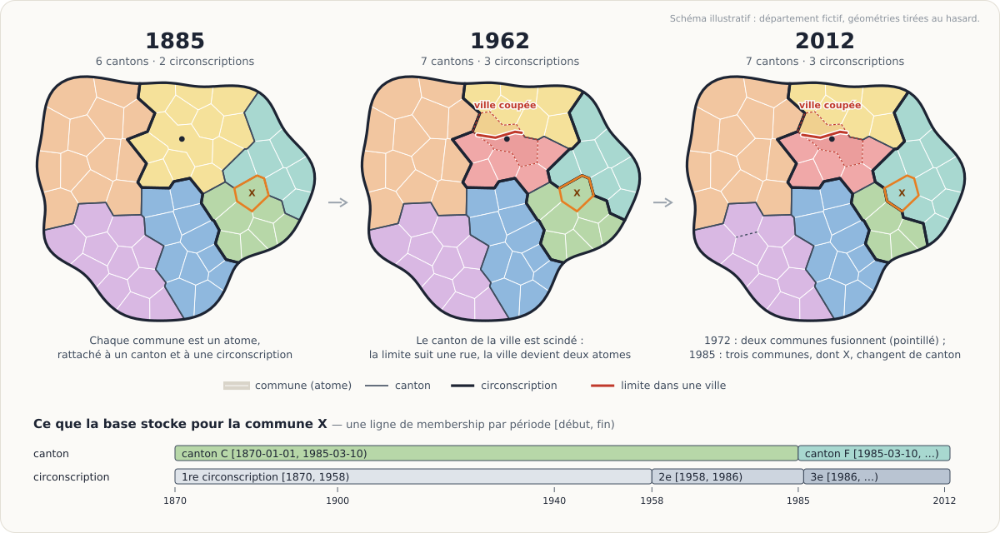
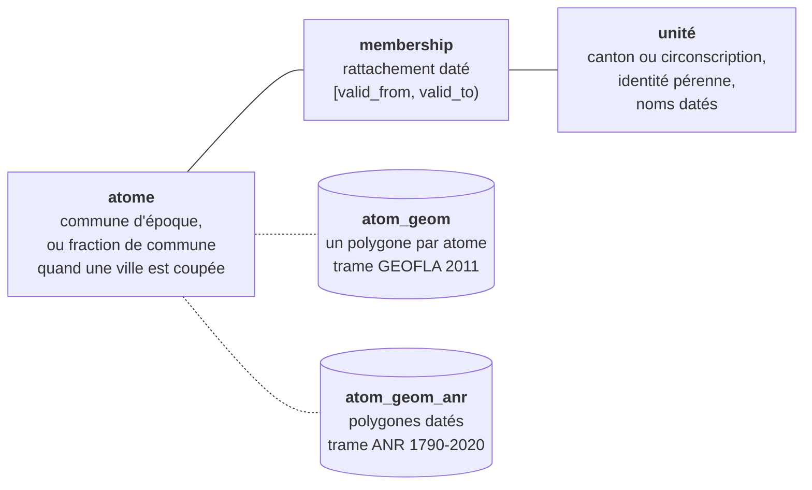
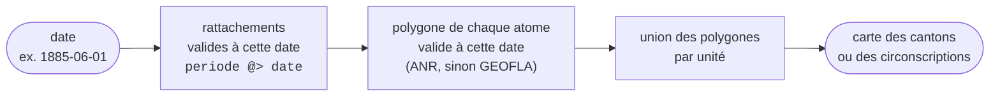
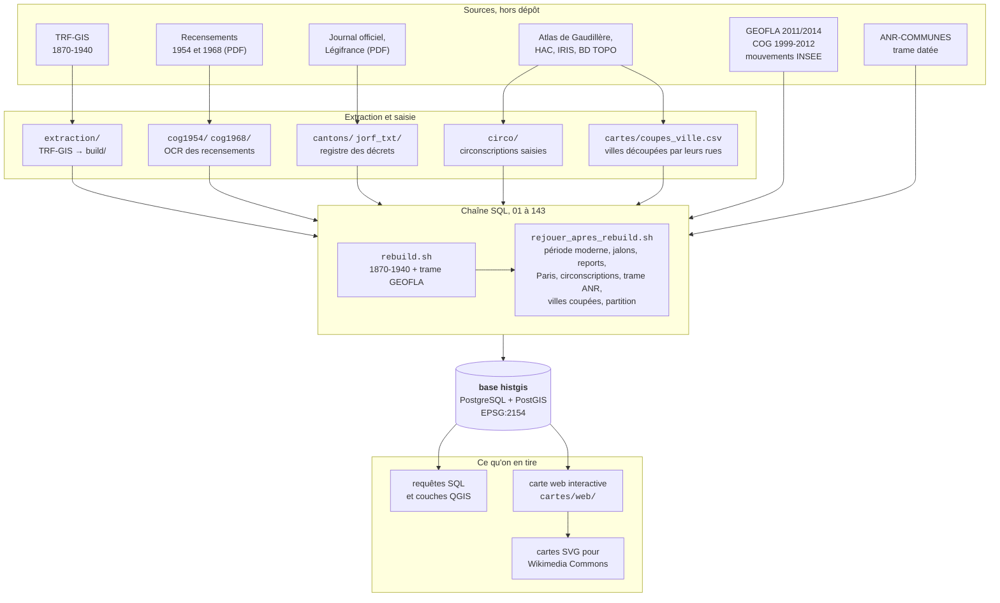
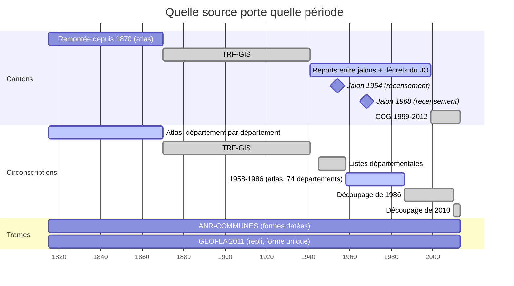
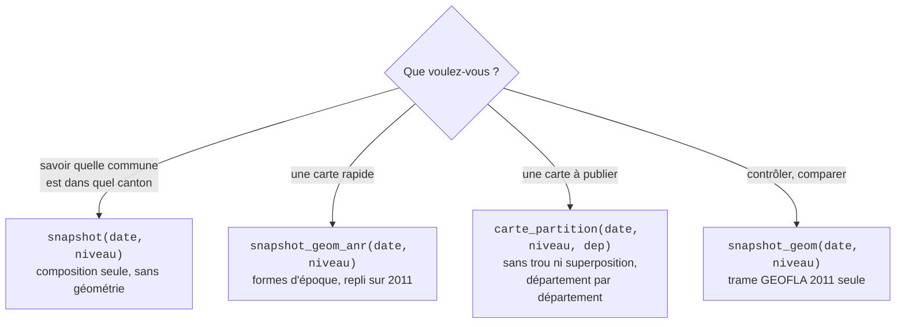
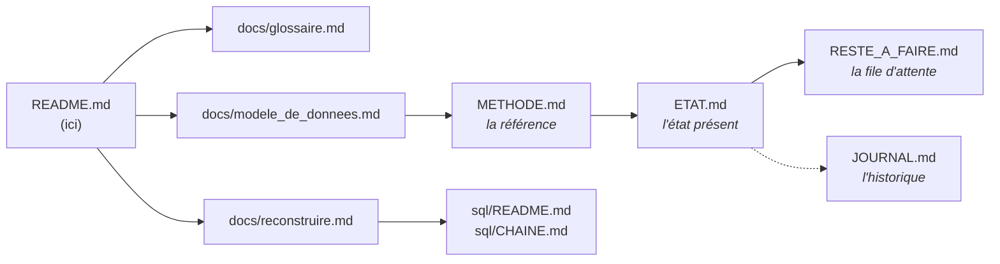

# histgis-fr — la carte administrative et électorale de la France, à n'importe quelle date

**Quelle était la carte des cantons et des circonscriptions législatives
françaises le 1ᵉʳ juin 1885 ? Et le 1ᵉʳ janvier 1962 ?** Ce dépôt construit une
base PostgreSQL/PostGIS qui répond à ce genre de question, géométries comprises.

<p align="center">
  
</p>
<p align="center"><sub>Schéma illustratif, sur un département fictif : les communes
ne bougent pas, leur rattachement change. Image produite par
<a href="docs/images/genere_illustration.py"><code>docs/images/genere_illustration.py</code></a>.</sub></p>

- **Période couverte** : 1870-2012 pour la métropole. Paris et la Seine
  remontent à 1815, comme désormais les cantons et une partie des
  circonscriptions du reste de la France. L'outre-mer est traité à part.
- **Niveaux** : communes, cantons et circonscriptions législatives.
- **Projection** : Lambert-93 (EPSG:2154), partout et sans exception.
- **Finalité** : alimenter Wikipédia, Wikidata et Wikimedia Commons. D'où une
  contrainte forte sur les licences des sources (voir
  [Sources et licences](#sources-et-licences)).

> **In English, in short.** *histgis-fr* builds a PostGIS database of French
> historical administrative boundaries (cantons and parliamentary
> constituencies, 1870-2012, Paris and the cantons from 1815), queryable at any
> date: `SELECT * FROM snapshot_geom_anr('1885-06-01', 'canton')`. The
> repository holds the code, the SQL pipeline, the hand-curated CSV files and
> the research notes. It does **not** hold the source data or the database
> itself: these must be downloaded and rebuilt (see
> [`docs/reconstruire.md`](docs/reconstruire.md)). All documentation is in
> French.

**Sommaire** —
[Le principe](#le-principe--séparer-la-géométrie-de-lappartenance) ·
[D'où viennent les données](#doù-viennent-les-données) ·
[Couverture dans le temps](#couverture-dans-le-temps) ·
[Interroger la base](#interroger-la-base) ·
[Ce que contient le dépôt](#ce-que-contient-le-dépôt-et-ce-quil-ne-contient-pas) ·
[Plan du dépôt](#plan-du-dépôt) ·
[Par où commencer](#par-où-commencer-la-lecture) ·
[Sources et licences](#sources-et-licences) ·
[Où en est le projet](#où-en-est-le-projet-novembre-2026) ·
[Contribuer](#contribuer-signaler-une-erreur)

---

## Le principe : séparer la géométrie de l'appartenance

Les limites des cantons et des circonscriptions ont changé des milliers de
fois depuis 1870 : créations, scissions, fusions de communes, redécoupages
électoraux. Il existe des cartes ponctuelles (une année ici, un département
là), mais pas de série continue, datée au jour près et dessinable.

L'idée centrale du projet est de **ne jamais stocker une carte**, mais trois
choses séparées :



- Un **atome** est la plus petite unité dont le rattachement est stable :
  presque toujours une commune d'époque, parfois une fraction de commune quand
  une ville est partagée entre plusieurs cantons.
- Une **unité** est un canton ou une circonscription. Son identité est pérenne
  et ses noms sont datés.
- Un **rattachement** (`membership`) dit que tel atome appartient à telle unité
  pendant tel intervalle `[valid_from, valid_to)`, borne de fin exclue.

**La carte d'une date se calcule à la demande** :



Ce découplage permet de changer de fond géométrique sans toucher à une seule
attribution, ce qui a déjà servi une fois (passage de la trame GEOFLA 2011 à
la trame datée ANR-COMMUNES, en septembre 2026). Le détail est dans
[`docs/modele_de_donnees.md`](docs/modele_de_donnees.md).

La cohérence est garantie par la base elle-même, pas par le code de
chargement. Des contraintes `EXCLUDE USING gist` interdisent qu'un atome
appartienne à deux cantons au même instant, qu'une unité porte deux noms au
même instant, ou qu'un atome ait deux polygones à la même date.

---

## D'où viennent les données

Aucune source ne couvre seule la période. La base les croise, et plusieurs
servent à se contrôler mutuellement. La chaîne de chargement est une suite de
fichiers SQL numérotés, joués dans l'ordre par deux scripts.



Les contrôles sont des requêtes en lecture seule qui ne modifient rien :
`sql/diag/diag_passages.sql` dit quels fichiers sont réellement passés,
`sql/controle_gay.sh` confronte la base aux cantons dissous publiés par
Victor Gay, et les fonctions `check_*` mesurent trous et superpositions
(voir [`docs/modele_de_donnees.md`](docs/modele_de_donnees.md#les-contrôles)).

---

## Couverture dans le temps

Chaque couche repose sur des sources différentes selon l'époque. Entre deux
sources sûres, la base reporte un rattachement « par les deux bouts » et le
confronte aux décrets lus au Journal officiel.



Pas de circonscription de 1940 à 1945, faute d'élections. De 1945 à 1958, le
scrutin est de liste et la circonscription est le département (la Seine est
découpée en secteurs). Le régime de chaque année est dans la table
`regime_electoral`. Paris et la Seine ont leur propre série, quartier par
quartier, de 1815 à 1986. Le détail de chaque couche et ses effectifs mesurés
sont dans `ETAT.md`.

---

## Interroger la base

Une fois la base construite :

```sql
SET search_path TO histgis, public;

-- Les cantons au 1ᵉʳ juin 1885 : composition, sans géométrie
SELECT * FROM snapshot('1885-06-01', 'canton');

-- Les mêmes, dessinés sur la trame communale historique, datée (ANR-COMMUNES)
SELECT unit_id, nom, geom FROM snapshot_geom_anr('1885-06-01', 'canton');

-- Dessinés sur la trame communale de 2011 (GEOFLA) : la référence des contrôles
SELECT unit_id, nom, geom FROM snapshot_geom('1885-06-01', 'canton');

-- La carte « propre » : sans trou ni superposition, pour un département
SELECT unit_id, nom, geom FROM carte_partition('1885-06-01', 'canton', '01');

-- Les circonscriptions législatives à la même date
SELECT unit_id, nom, geom FROM snapshot_geom_anr('1885-06-01', 'circo');

-- Combien d'unités à cette date ?
SELECT * FROM count_units('1885-06-01');
```

Le résultat s'ouvre directement dans QGIS (connexion PostGIS, puis « Ajouter
une couche » sur une requête). Laquelle choisir :



**Règle de lecture essentielle** : *l'absence signifie « on ne sait pas », la
présence « on sait ».* La base ne comble pas un trou par interpolation. Une
date pour laquelle aucune source ne renseigne un canton ne renvoie rien pour
ce canton.

### La carte web

`cartes/web/` contient une page autonome avec un curseur d'années (1815-2012)
et un sélecteur de département, outre-mer compris. Les communes, les cantons
et les circonscriptions y sont superposés ; un bouton prépare et dépose sur
Wikimedia Commons, en SVG sous CC BY-SA 4.0, la carte affichée.

```bash
python3 cartes/export_web.py      # exporte depuis la base (long : tous les départements)
python3 cartes/web/servir.py      # ouvre http://127.0.0.1:8765/index.html
```

Le mode d'emploi est dans [`cartes/web/LISEZMOI.md`](cartes/web/LISEZMOI.md).

---

## Ce que contient le dépôt, et ce qu'il ne contient pas

**Il contient** :

- le code qui extrait les sources (Python) ;
- la chaîne de chargement de la base (SQL : plus de 120 fichiers numérotés de
  01 à 143, leurs scripts de jeu, des bancs d'essai et des diagnostics) ;
- les tableaux saisis ou dépouillés à la main (CSV) : décrets, recensements,
  circonscriptions de Paris, villes à découper, etc. ;
- la carte web interactive (une page HTML et son script d'export) ;
- les notes de recherche, qui documentent chaque choix et chaque limite.

**Il ne contient pas** :

- **les données sources** : environ 11 Go de shapefiles, de GeoPackages, de
  PDF de Journaux officiels et de fascicules de recensement, à retélécharger ;
- **la base elle-même** : aucun dump n'est versionné ;
- **l'export de la carte web** (`cartes/web/donnees/`, plusieurs Go), qui se
  régénère depuis la base.

Autrement dit, **cloner le dépôt ne suffit pas à voir une carte**. Il faut
réunir les sources et rejouer la chaîne. La procédure est décrite dans
[`docs/reconstruire.md`](docs/reconstruire.md).

---

## Plan du dépôt

```
.
├─ README.md                 ← vous êtes ici
├─ docs/                     documentation d'accueil : glossaire, modèle de données,
│  │                         reconstruction ; notes thématiques (outre-mer,
│  │                         circonscriptions, 1943-2012) et BASE_POUR_QGIS.md
│  ├─ images/                l'illustration du README et son script
│  └─ gaudillere/            Marseille : protocole de géoréférencement
│
├─ LISEZMOI.md               carte détaillée du dossier de travail, par l'auteur
├─ METHODE.md                la référence : architecture, sources, limites, règles de travail
├─ ETAT.md                   où en est chaque couche, avec ses effectifs mesurés
├─ RESTE_A_FAIRE.md          la file d'attente, classée par valeur
├─ JOURNAL.md                le récit chronologique complet (plus de 11 000 lignes)
│
├─ environment.yml           environnement conda (Python, GDAL, tesseract…)
├─ geom_correspondance.csv   correspondances communes disparues → polygone, saisies à la main
│
├─ extraction/               tête de chaîne : trfgis_extract.py (TRF-GIS → build/),
│  │                         trfgis_fetch_inspect.py (téléchargement depuis Harvard Dataverse)
│  ├─ anr/                   arbitrage des variantes de la trame ANR (→ build/anr_variantes.csv)
│  └─ hac/                   filiation communale extraite de HAC (contrôle indépendant)
├─ sql/                      LA CHAÎNE : fichiers 01 à 143, scripts de reconstruction
│  ├─ diag/                  diagnostics en lecture seule
│  └─ bancs/                 bancs d'essai sur base jetable
├─ cantons/                  registre des mouvements cantonaux : décrets, Journal officiel,
│  └─ wikipedia/             Légifrance, annexe VII de Gaudillère, récolte Wikipédia
├─ circo/                    circonscriptions législatives (1815-1870, 1958-1986, 1986,
│                            2010, outre-mer) et tout Paris/la Seine depuis 1815
├─ cog1954/  cog1968/        dépouillement OCR des recensements de 1954 et 1968
├─ cartes/                   découpe des villes multicantonales, export de la carte
│  └─ web/                   la carte interactive et l'export vers Wikimedia Commons
├─ outils/                   code partagé : connexion à la base, clé des noms
├─ jorf_txt/                 texte OCR des Journaux officiels utilisés
├─ archives/                 premières explorations et planches PDF, conservées pour mémoire
└─ .claude/skills/           procédure outillée pour la découpe d'une ville
```

Dans chaque dossier, les fichiers `note_*.md` expliquent la source traitée,
la méthode suivie et les écueils rencontrés. Les CSV de travail sont rangés à
côté du script qui les produit.

---

## Par où commencer la lecture

Selon ce que vous cherchez :

| vous voulez… | lisez |
|---|---|
| comprendre les termes (canton, atome, jalon, Gaudillère…) | [`docs/glossaire.md`](docs/glossaire.md) |
| interroger la base ou réutiliser son modèle | [`docs/modele_de_donnees.md`](docs/modele_de_donnees.md) |
| reconstruire la base chez vous | [`docs/reconstruire.md`](docs/reconstruire.md) |
| utiliser la carte web ou déposer une carte sur Commons | [`cartes/web/LISEZMOI.md`](cartes/web/LISEZMOI.md) |
| savoir ce qui est fiable et ce qui ne l'est pas | `ETAT.md` § 4 puis `METHODE.md` § 6 et § 7 |
| reprendre le travail | `METHODE.md` (en entier), puis `ETAT.md`, puis `RESTE_A_FAIRE.md` |
| comprendre pourquoi une décision a été prise | rechercher le sujet dans `JOURNAL.md`, qui est daté |
| connaître le rôle d'un fichier SQL précis | `sql/CHAINE.md`, puis `sql/README.md` (dépendances) |



Les documents internes (`METHODE.md`, `ETAT.md`, `JOURNAL.md`…) ont été écrits
au fil du travail, par et pour l'auteur. Ils sont précis mais denses. Ils
citent parfois des chemins absolus de la machine d'origine
(`~/Téléchargements/projet_carte`) et des effectifs datés : **un chiffre n'y
vaut qu'à la date de sa mesure**.

---

## Sources et licences

| source | apport | licence |
|---|---|---|
| **TRF-GIS** (Victor Gay, Harvard Dataverse) | nomenclatures communes → cantons → circonscriptions, 1870-1940, 71 millésimes | CC BY 4.0 |
| **GEOFLA 2011 et 2014** (IGN) | trame communale de 2011, cantons de 2014 (étalon) | Licence Ouverte |
| **ANR-COMMUNES** (Zenodo `10.5281/zenodo.3727274`) | trame communale historique datée, 1790-2020 | voir Zenodo |
| **Mouvements de communes** (INSEE) | fusions, scissions et renommages depuis 1943 | Licence Ouverte |
| **COG 1999-2012** (INSEE) | nomenclature cantonale moderne | Licence Ouverte |
| **Recensements de 1954 et 1968** (INSEE, BnSP) | composition cantonale au milieu de la période | domaine public |
| **Journal officiel, Légifrance** | décrets de création et de modification des cantons | domaine public |
| **HAC** (*Des villages de Cassini aux communes d'aujourd'hui*, EHESS) | filiation des communes depuis 1801 | — |
| **Gaudillère**, *Atlas historique des circonscriptions électorales françaises* (Droz, 1995) | mouvements cantonaux datés au décret, villes divisées, circonscriptions 1815-1870 et 1958-1986 | — |
| **CONTOURS-IRIS** (INSEE-IGN) | trame infra-communale pour découper les villes et reconstituer les quartiers de Paris | Licence Ouverte 2.0 |
| **BD TOPO** (IGN) | voirie et cours d'eau, pour tracer les limites qui passent dans les villes | Licence Ouverte |

DOI, URL et pièges de lecture de chaque source : `METHODE.md` § 3,
`LISEZMOI.md` et [`docs/reconstruire.md`](docs/reconstruire.md).

**Contrainte de licence** : comme le projet alimente Wikipédia et Wikidata,
toute source *intégrée* doit être sous CC BY-SA ou Licence Ouverte/Etalab, et
vérifiable par une URL publique. Cela exclut délibérément des jeux de données
pourtant excellents, sous ODbL (quartiers de la Ville de Paris,
ALPAGE-Vasserot) ou CC BY-NC-SA (Cassini-Geopeuple).

**Licence du dépôt** : le code est sous GNU GPL v3 (voir [`LICENSE`](LICENSE)).
Les données dérivées restent soumises aux licences de leurs sources, et toute
réutilisation doit citer ces sources, en particulier TRF-GIS (CC BY 4.0).

---

## Où en est le projet (novembre 2026)

| couche | état |
|---|---|
| cantons 1815-1870 | le canton de 1870 remonté à 1815, sauf les exceptions relevées dans l'atlas ; France entière |
| cantons 1870-1940 | complète, contrôlée contre les cantons dissous publiés par Gay |
| cantons 1941-1998 | reconstituée à partir de jalons (recensements de 1954 et 1968) et des décrets lus au Journal officiel, avec des trous résiduels en cours de lecture |
| cantons 1999-2012 | complète, contrôlée contre GEOFLA 2014 |
| circonscriptions | 1815-1870 (département par département), 1870-1940 (TRF-GIS), 1945-1958 (listes départementales), 1958-1986 (74 départements), 1986-2010 et 2010-2013 ; Paris et la Seine depuis 1815 |
| trame géométrique | deux trames : GEOFLA 2011 (une forme par commune) et ANR-COMMUNES (formes datées) |
| villes partagées entre plusieurs cantons | 315 villes repérées ; 154 communes et 15 quartiers de Paris ont déjà leurs lignes de coupe, tracées dans la voirie (854 lignes dans `cartes/coupes_ville.csv`) |
| outre-mer | traité dans un espace séparé (`om_*`), Pacifique compris |

Le détail et les chiffres sont dans `ETAT.md`. Les limites connues, **à
mentionner en légende de toute carte publiée**, sont dans `ETAT.md` § 4. Les
deux principales :

- **Recouvrements** : quelques communes d'époque fondues depuis partagent un
  même polygone moderne. Sur la trame GEOFLA, cela fait environ 3 900 km²
  comptés deux fois en 1870 ; la trame ANR ramène ce chiffre à une centaine de
  km², et `carte_partition` les supprime.
- **Villes coupées** : Marseille, Lyon, Bordeaux et d'autres sont partagées
  entre plusieurs cantons par des limites de rues. Tant que la ligne n'est pas
  tracée, les fractions de la ville portent toutes le polygone de la ville
  entière, et la carte le signale par un motif.

---

## Contribuer, signaler une erreur

Une erreur de rattachement se signale de préférence avec sa **source** : le
décret, la page du recensement ou la planche de Gaudillère qui la contredit.
Le projet ne corrige pas une donnée « parce qu'elle a l'air fausse », mais
parce qu'une source datée dit autre chose. C'est ainsi que sont tenus
`cantons/mouvements_cantonaux.csv` et `cartes/coupes_ville.csv`.

Avant toute modification de la chaîne SQL, lisez « Qui dépend de qui » dans
`sql/README.md`. Un fichier rejoué isolément peut défaire en silence le
travail d'un autre.

Auteur : Adrien Dufour.
